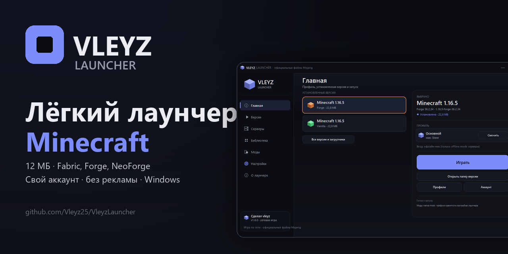
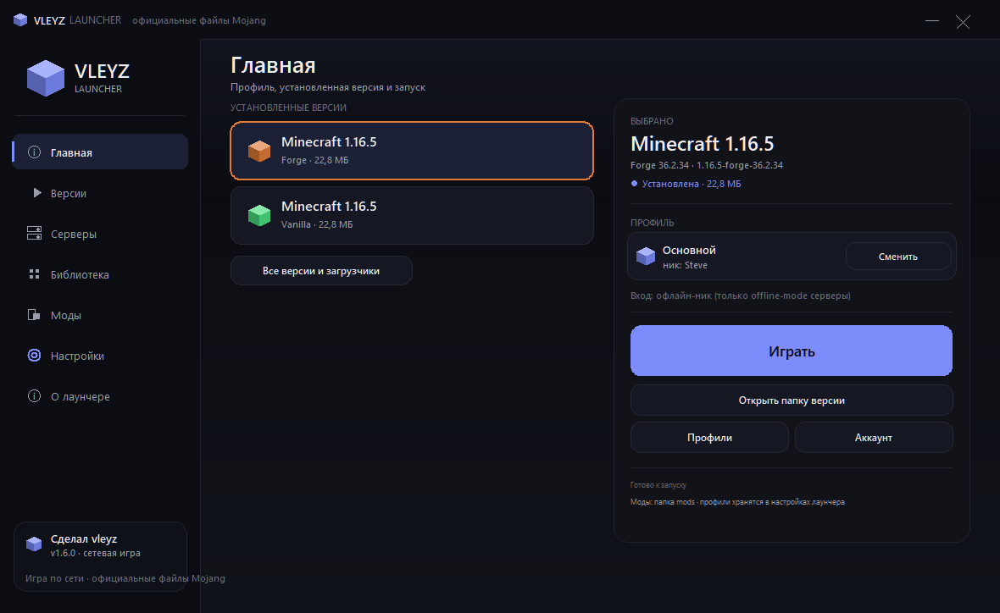
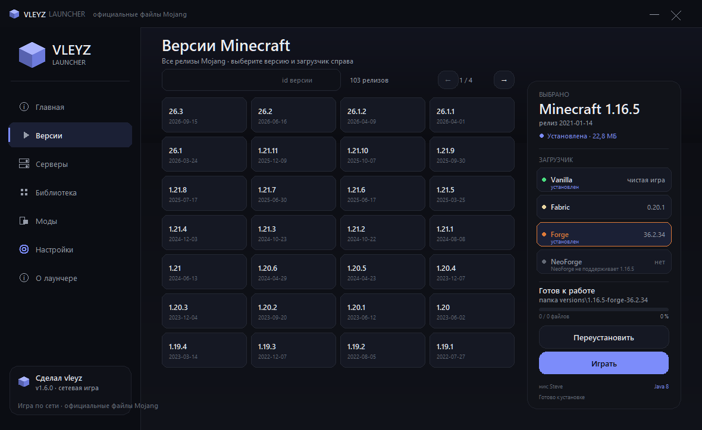
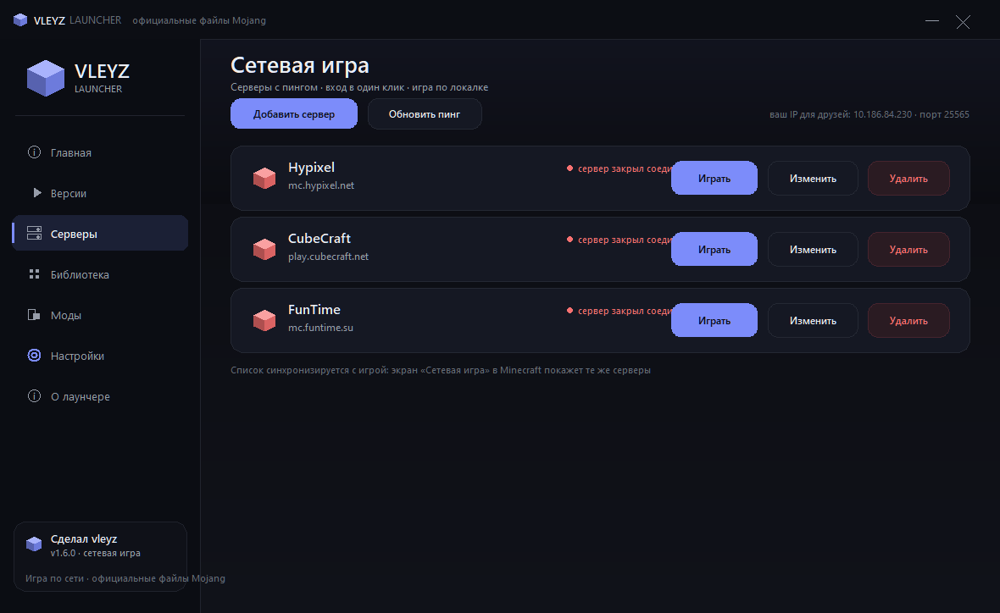
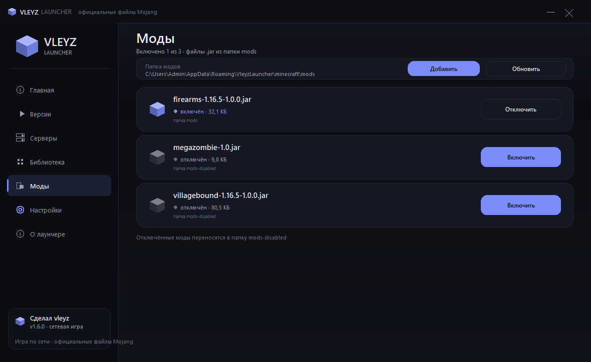
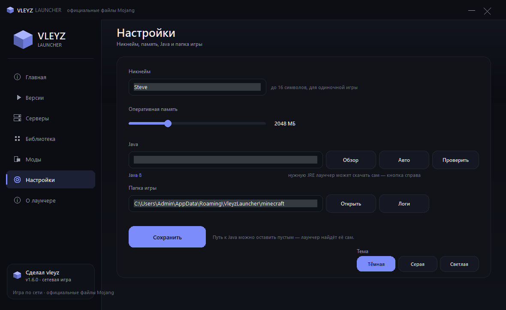
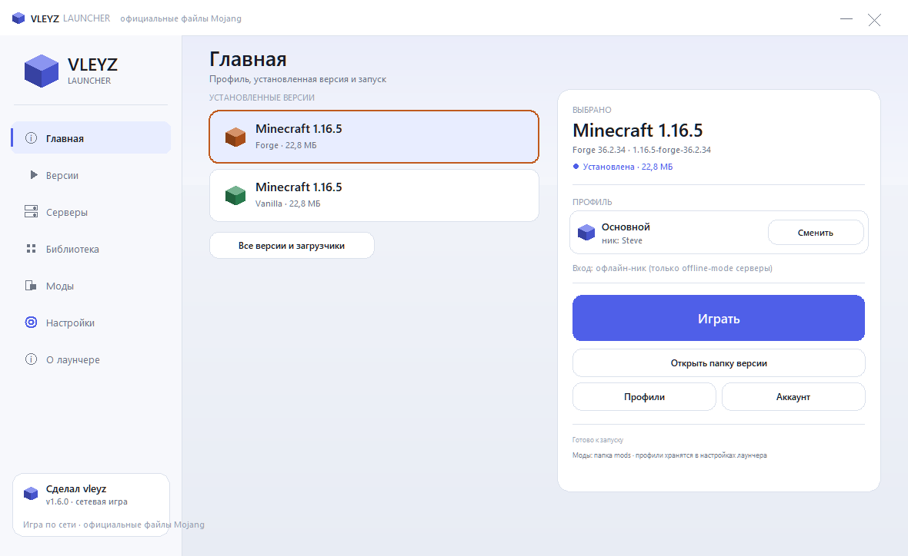

<div align="center">



# Vleyz Launcher

**A light Minecraft launcher built on Python + tkinter: 12 MB, official Mojang files, no ads and no telemetry.**

[](https://github.com/Vleyz25/VleyzLauncher/releases/latest)
[](https://github.com/Vleyz25/VleyzLauncher/releases)
[](LICENSE)
[](https://www.python.org/)
[](#)

[**Website**](https://vleyz25.github.io/VleyzLauncher/) · [**Download the installer**](https://github.com/Vleyz25/VleyzLauncher/releases/latest) · [What's new](CHANGELOG.md) · [Report an issue](https://github.com/Vleyz25/VleyzLauncher/issues) · [По-русски](README.md)

</div>

---

## Why another launcher

- **12 MB instead of half a gigabyte.** No Electron, no browser inside: Python, tkinter and a hand-drawn canvas UI.
- **Official files only.** Versions, libraries and assets come from Mojang servers, and every file is verified by SHA1.
- **No ads, no telemetry, no "boosters".** Settings live in your user profile and `.minecraft` is left untouched.
- **No manual Java setup.** If the right version is missing, the launcher downloads a JRE from Adoptium and keeps it.

## What it does

- Shows every Mojang release in a grid, with search and paging. Only what you pick gets downloaded.
- Installs **Fabric** as a profile, **Forge** and **NeoForge** through their official maven installers.
- Keeps several profiles with different nicknames — handy for different servers.
- Sign-in: offline nickname, **Ely.by** or a **Microsoft** account with a device code. The launcher never asks for or stores your Microsoft password.
- Your own server list with ping: MOTD, online count, version, latency. The Play button connects straight to a server and the list shows up in the in-game Multiplayer screen.
- Mods: shows `.jar` files from the `mods` folder and toggles them with one click.
- Modrinth search built in: finds a mod, picks the loader and game version, installs it together with its dependencies.
- Ready-made modpacks: `.mrpack` from Modrinth and zips with a `mods` folder — files are verified by SHA1 and overrides are unpacked into the instance.
- Mod updates: compares installed `.jar` files with Modrinth by SHA1 and installs newer versions, one by one or all at once.
- Resource packs and shaders from Modrinth: search, install, toggle with one click.
- World backups: a zip of the `saves` folder, the last 5 are kept, restoring never loses the current worlds.
- Skin preview by nickname and saving the image.
- Instances: each build gets its own `mods`, `saves` and `config`, so modpacks do not collide.
- JVM arguments field in settings, next to the memory slider.
- Three themes: dark, grey, light.
- Two languages: Russian and English, switchable on the Settings page.
- Update check and one-click install: downloads, installs, restarts by itself.
- Resumable downloads and a "Verify files" button with SHA1 checks.
- Logs and readable errors: if something breaks there is a file with details instead of a silent exit.

## Screenshots

| Home | Versions and loaders |
| --- | --- |
|  |  |
| **Servers with ping** | **Mods** |
|  |  |
| **Settings** | **Light theme** |
|  |  |

## Installation

1. Open the [latest release](https://github.com/Vleyz25/VleyzLauncher/releases/latest).
2. Download `VleyzLauncher-Setup.exe` and run it.
3. Open "Versions", pick a build and click "Download".
4. Wait for the download and press "Play".

There is also `VleyzLauncher-portable.zip` — a single exe with no installation and no shortcuts.

> Windows may warn about an "Unknown publisher": the project has no paid code-signing certificate yet. Sources are open and SHA256 sums are published in the release, so you can build it yourself.

The launcher installs the game into `%APPDATA%\VleyzLauncher\minecraft` and downloaded JREs into `%APPDATA%\VleyzLauncher\java`. The game folder can be changed in settings; `.minecraft` is never touched.

### From source

```bash
git clone https://github.com/Vleyz25/VleyzLauncher.git
cd VleyzLauncher
python main.py
```

Python 3.10+ and Windows are required. Or just `run.bat`.

### Building

```bash
pip install pyinstaller
python -m PyInstaller --noconfirm VleyzLauncher.spec
python -m PyInstaller --noconfirm VleyzLauncherSetup.spec
```

The finished files land in `dist/`. The portable archive and release SHA256 sums are produced with the same commands plus `Compress-Archive`.

## Security and privacy

- **No telemetry.** The launcher sends no statistics beyond ordinary requests to Mojang, Ely.by, Adoptium, Modrinth and GitHub (update check).
- **Encrypted tokens.** The Ely.by password and tokens and Microsoft tokens are stored encrypted with Windows DPAPI and cannot be read on another PC or under another user account.
- **Config in your profile.** `%APPDATA%\VleyzLauncher\config.json`, logs in `%APPDATA%\VleyzLauncher\logs\`. An old file next to the exe is migrated automatically.
- **File verification.** Downloads are checked against SHA1 and size; corrupted or substituted files are rejected.
- **No bundled assets.** The installer contains no game, music or textures — those are downloaded from Mojang.

## Command line

```bash
python main.py --version
python main.py --list
python main.py --install 1.20.1 --loader fabric
python main.py --command 1.20.1 --server mc.example.com:25577
```

## How it is put together

```
main.py                     entry point: GUI or CLI (--list, --install, --command, --version)
vleyzlauncher/core/         all the logic, no tkinter
  versions.py               Mojang manifest, OS rules, inheritsFrom merging
  installer.py              file downloads, natives, running Forge installers
  loaders.py                Fabric / Forge / NeoForge
  launch.py                 building the java command and launching
  servers.py                server ping, SRV, servers.dat
  microsoft.py, elyby.py    account sign-in
  java.py                   finding Java and downloading JREs
  mods.py, profiles.py      mods and profiles
  instances.py              per-build mods, saves and config
  modrinth.py               Modrinth search and install
  paths.py, secure.py       config in the profile, secret encryption
  updates.py                GitHub release check
  logging_setup.py          logs and error capture
vleyzlauncher/ui/           canvas UI
vleyzlauncher/i18n.py       Russian and English strings
tools/                      icon build, tests, installer
tests/                      core unit tests
```

## Known limitations

- Official servers only accept a Microsoft account with a purchased copy of the game. With an offline nickname or Ely.by you can join servers running `online-mode=false`, Ely.by servers and LAN worlds.
- NeoForge only from 1.20.2. For 1.20.1 use Forge or Fabric.
- CurseForge packs are unpacked for overrides only: without an API key the launcher does not download their mod files.
- The first Forge launch takes longer — Java and libraries are being downloaded.

## Plans

- [x] Launcher update check.
- [x] Automatic one-click update install.
- [x] Resumable downloads and file verification.
- [x] Modrinth: mod search and install with dependencies.
- [x] Instances: separate `mods`, `saves` and `config` per build.
- [x] JVM arguments in settings, not just memory.
- [x] English interface and README.

## Supporting the project

Star the repo if the launcher was useful. Bugs and ideas go to [Issues](https://github.com/Vleyz25/VleyzLauncher/issues), where report and feature templates are waiting.

Minecraft is a trademark of Mojang Studios. This project is not affiliated with Mojang. Play only on an account that belongs to you.

---

Made by [vleyz](https://github.com/Vleyz25). Licensed under [MIT](LICENSE).
