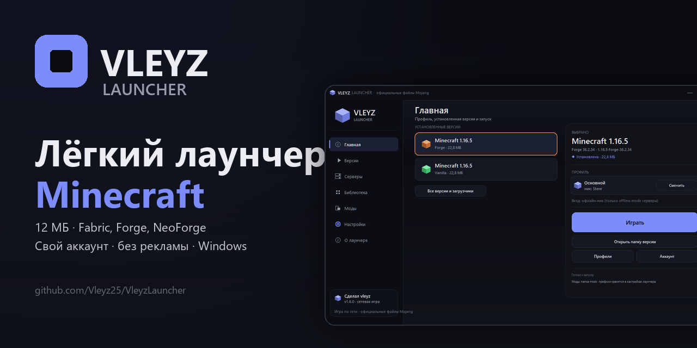
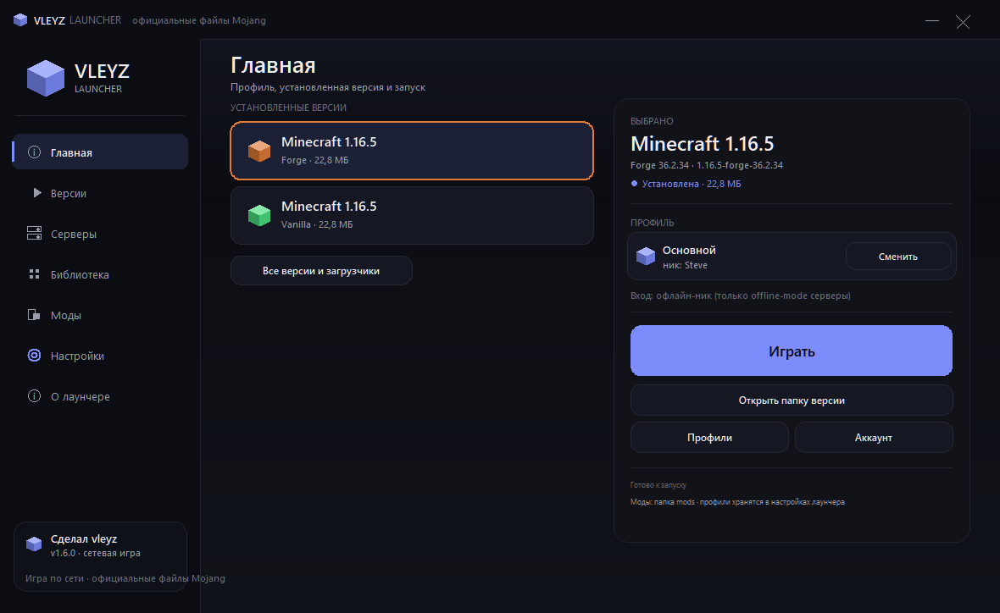
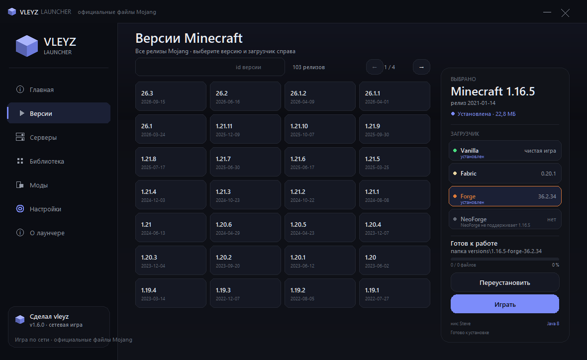
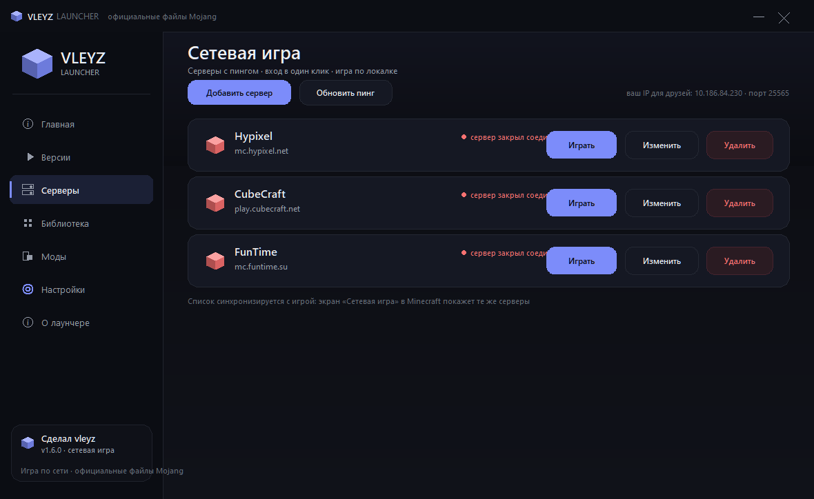
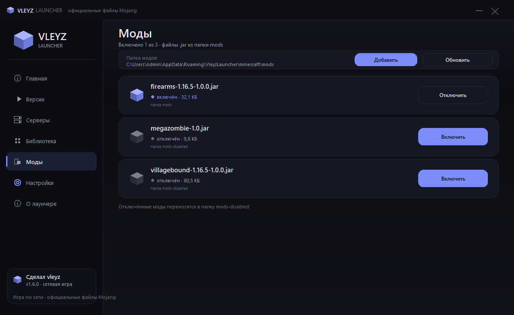
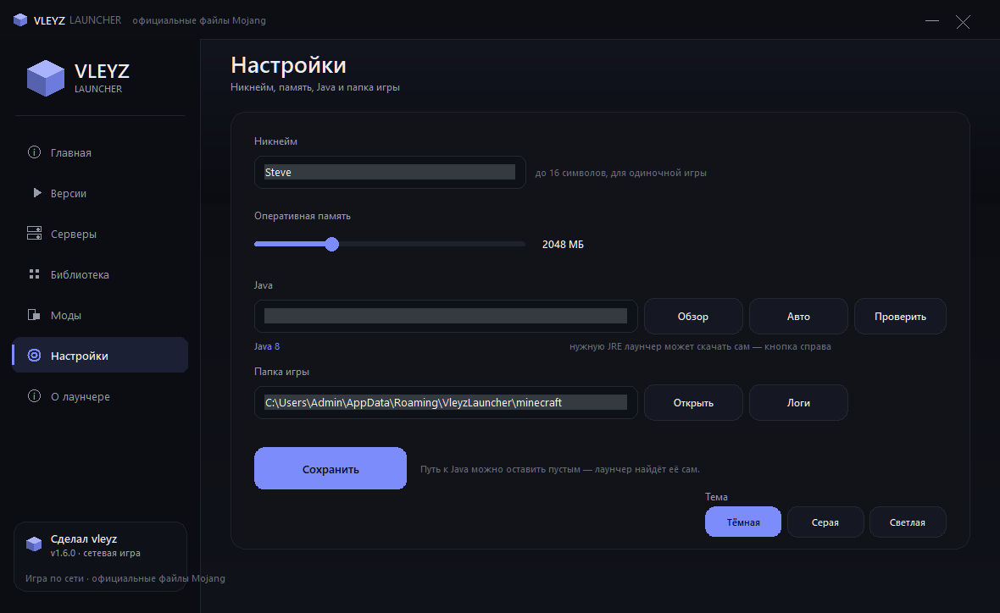
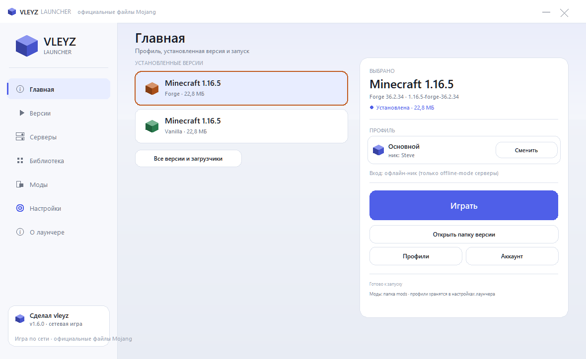

<div align="center">



# Vleyz Launcher

**Лёгкий лаунчер Minecraft на Python + tkinter: 12 МБ, официальные файлы Mojang, без рекламы и телеметрии.**

[](https://github.com/Vleyz25/VleyzLauncher/releases/latest)
[](https://github.com/Vleyz25/VleyzLauncher/releases)
[](LICENSE)
[](https://www.python.org/)
[](#)

[**Сайт**](https://vleyz25.github.io/VleyzLauncher/) · [**Скачать установщик**](https://github.com/Vleyz25/VleyzLauncher/releases/latest) · [Что нового](CHANGELOG.md) · [Написать о проблеме](https://github.com/Vleyz25/VleyzLauncher/issues) · [English](README.en.md)

</div>

---

## Почему ещё один лаунчер

- **12 МБ вместо полугигабайта.** Ни Electron, ни браузера внутри: Python, tkinter и свой интерфейс на канве.
- **Только официальные файлы.** Версии, библиотеки и ассеты качаются с серверов Mojang, каждый файл сверяется по SHA1.
- **Без рекламы, телеметрии и «бустеров».** Настройки лежат в профиле пользователя, `.minecraft` не трогается.
- **Не надо ставить Java вручную.** Если нужной версии нет, лаунчер скачает JRE с Adoptium и будет держать её у себя.

## Что умеет

- Показывает все релизы Mojang сеткой, с поиском и страницами. Скачивается только выбранное.
- Ставит **Fabric** профилем, **Forge** и **NeoForge** — их официальными установщиками с maven.
- Держит несколько профилей с разными никами — удобно для разных серверов.
- Вход: офлайн-ник, **Ely.by** или аккаунт **Microsoft** по коду устройства. Пароль Microsoft лаунчер не спрашивает и не хранит.
- Свой список серверов с пингом: MOTD, онлайн, версия, задержка. Кнопка «Играть» сразу подключает к серверу, список подхватывается игрой на экране «Сетевая игра».
- Моды: показывает `.jar` из папки `mods`, включает и отключает одним кликом.
- Поиск по **Modrinth**: находит мод, сам подбирает загрузчик и версию игры, ставит его вместе с зависимостями.
- Готовые сборки: `.mrpack` из Modrinth и zip с папкой `mods` — файлы качаются по SHA1, overrides раскладываются по папкам сборки.
- Обновления модов: сверяет `.jar` с Modrinth по SHA1 и ставит новые версии — по одной или все сразу.
- Ресурспаки и шейдеры из Modrinth: поиск, установка, включение и отключение в один клик.
- Бэкапы миров: zip папки `saves`, хранятся 5 последних, восстановление не теряет текущие миры.
- Скин: превью головы по нику и сохранение картинки.
- Инстансы: у каждой сборки своя папка `mods`, `saves` и `config`, сборки не мешают друг другу.
- Поле аргументов JVM в настройках — рядом с ползунком памяти.
- Три темы: тёмная, серая, светлая.
- Два языка: русский и английский, переключаются в настройках.
- Проверка обновлений и установка в один клик: скачал, поставил, лаунчер перезапустился.
- Докачка оборванных загрузок и кнопка «Проверить файлы» с проверкой SHA1.
- Логи и понятные ошибки: если что-то упало, есть файл с подробностями, а не молчаливое закрытие.

## Как выглядит

| Главная | Версии и загрузчики |
| --- | --- |
|  |  |
| **Серверы с пингом** | **Моды** |
|  |  |
| **Настройки** | **Светлая тема** |
|  |  |

## Установка

1. Откройте [последний релиз](https://github.com/Vleyz25/VleyzLauncher/releases/latest).
2. Скачайте `VleyzLauncher-Setup.exe` и запустите.
3. Откройте «Версии», выберите сборку и нажмите «Скачать».
4. Дождитесь загрузки и жмите «Играть».

Есть и `VleyzLauncher-portable.zip` — один exe без установки и ярлыков.

> Windows может показать «Неизвестный издатель»: у проекта пока нет платной подписи кода. Исходники открыты, SHA256 файлов лежат в релизе — при желании можно собрать самому.

Лаунчер встаёт в подпапку `VleyzLauncher` внутри выбранного места, и все версии игры, Java и логи лежат там же — рядом ничего не создаётся. Папку игры можно поменять в настройках, `.minecraft` не затрагивается.

### Из исходников

```bash
git clone https://github.com/Vleyz25/VleyzLauncher.git
cd VleyzLauncher
python main.py
```

Нужен Python 3.10+ и Windows. Или `run.bat`.

### Сборка

```bash
pip install pyinstaller
python -m PyInstaller --noconfirm VleyzLauncher.spec
python -m PyInstaller --noconfirm VleyzLauncherSetup.spec
```

Готовые файлы появятся в `dist/`. Portable-архив и SHA256 для релиза собираются теми же командами и `Compress-Archive`.

## Безопасность и приватность

- **Никакой телеметрии.** Лаунчер не отправляет статистику, кроме обычных запросов к Mojang, Ely.by, Adoptium и GitHub (проверка обновлений).
- **Токены зашифрованы.** Пароль и токены Ely.by, токены Microsoft лежат в конфиге зашифрованными через Windows DPAPI и не читаются на другом ПК или под другой учётной записью.
- **Конфиг в профиле.** `%APPDATA%\VleyzLauncher\config.json`, логи — в `%APPDATA%\VleyzLauncher\logs\`. Старый файл рядом с exe переносится автоматически.
- **Проверка файлов.** Загрузки сверяются по SHA1 и размеру, битые и подменённые отбрасываются.
- **Ассеты не распространяются.** Лаунчер не кладёт в установщик игру, музыку или текстуры — только скачивает их у Mojang.

## Командная строка

```bash
python main.py --version
python main.py --list
python main.py --install 1.20.1 --loader fabric
python main.py --command 1.20.1 --server mc.example.com:25577
```

## Как это устроено

```
main.py                     вход: GUI или CLI (--list, --install, --command, --version)
vleyzlauncher/core/         вся логика, без tkinter
  versions.py               манифест Mojang, правила ОС, склейка inheritsFrom
  installer.py              загрузка файлов, нативы, запуск установщиков Forge
  loaders.py                Fabric / Forge / NeoForge
  launch.py                 сборка java-команды и запуск
  servers.py                пинг серверов, SRV, servers.dat
  microsoft.py, elyby.py    вход в аккаунты
  java.py                   поиск Java и скачивание JRE
  mods.py, profiles.py      моды и профили
  paths.py, secure.py       конфиг в профиле, шифрование секретов
  updates.py                проверка релизов GitHub
  logging_setup.py          логи и перехват ошибок
vleyzlauncher/ui/           интерфейс на канве
tools/                      сборка иконки, тесты, установщик
tests/                      unit-тесты ядра
```

## Что пока не работает

- Официальные серверы принимают только аккаунт Microsoft с купленной игрой. С офлайн-ником и Ely.by можно заходить на серверы с `online-mode=false`, на серверы Ely.by и в локалку.
- Кнопка «Сетевая игра» включена на всех версиях: для офлайн-профиля лаунчер локально отвечает на проверку прав клиента (`/privileges`), поэтому меню не гаснет. Официальные серверы всё равно требуют аккаунт Microsoft — проверку сессии это не обходит.
- NeoForge только с 1.20.2. Для 1.20.1 есть Forge и Fabric.
- Сборки CurseForge без ключа API разбираются только на overrides: файлы модов оттуда лаунчер не скачивает.
- Первый запуск Forge дольше обычного — качается Java и библиотеки.

## Планы

- [x] Проверка обновлений лаунчера.
- [x] Автоскачивание и установка обновления в один клик.
- [x] Докачка загрузок и проверка файлов.
- [x] Modrinth: поиск и установка модов с зависимостями.
- [x] Инстансы: отдельные `mods`, `saves` и `config` под каждую сборку.
- [x] Аргументы JVM в настройках, а не только память.
- [x] Английский интерфейс и README.

## Поддержать проект

Поставьте звезду, если лаунчер пригодился. Баги и идеи — в [Issues](https://github.com/Vleyz25/VleyzLauncher/issues), там же шаблоны для отчёта и предложения.

Minecraft — торговая марка Mojang Studios. К Mojang проект отношения не имеет. Играть можно только на аккаунте, который принадлежит вам.

---

Сделал [vleyz](https://github.com/Vleyz25). Лицензия — [MIT](LICENSE).
